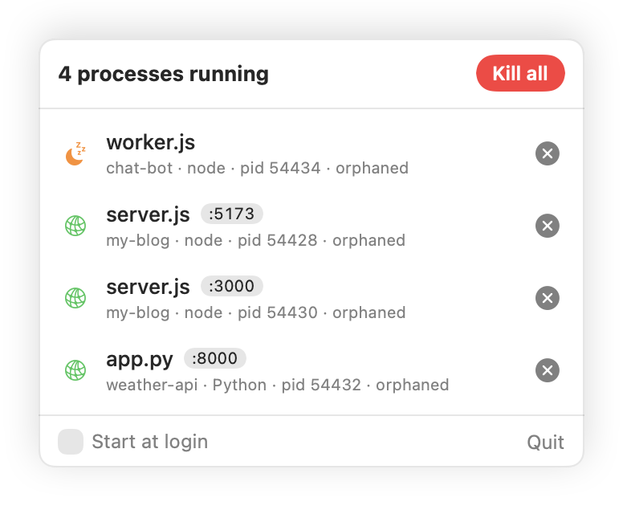
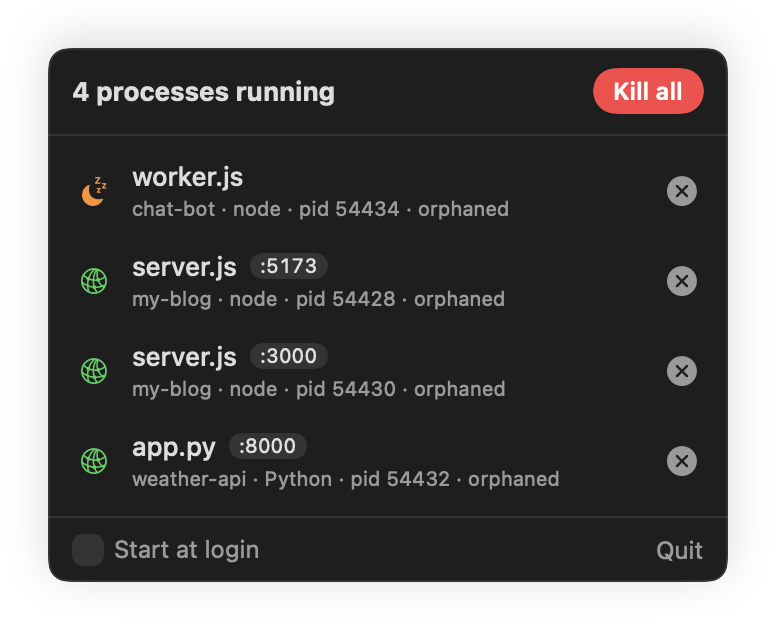

<h1 align="center">LightsOut</h1>

<p align="center">
  A tiny menu bar app that shows which dev servers and leftover processes are still running on your Mac.<br>
  If the menu bar icon is gone, everything is off.
</p>

<p align="center">
  
  
</p>

## Why

You start `npm run dev` in one terminal, a Python API in another, an AI agent spins up a server in the background, and a few hours later you have no idea what is still holding port 3000. LightsOut answers that with one glance at the menu bar.

## Features

- **Only there when it matters**: the ⚡ icon and count appear while something runs and disappear when everything is off.
- **See what's running**: script or module name, open ports, project folder, PID, and whether the process is orphaned.
- **Kill one or all**: ✕ on a row kills that process, **Kill all** clears the list. Processes first get a polite `SIGTERM`, then `SIGKILL` two seconds later if they are still alive.
- **Lightweight**: reads the process table straight from the kernel (libproc) every 3 seconds instead of spawning `ps` or `lsof`. Idles at ~0% CPU.
- **Native and small**: Swift + SwiftUI, no dependencies, no Dock icon. Starts at login.

## What gets listed

Only your own processes, never system services or regular apps.

| Process | Listed when |
| --- | --- |
| Dev runtimes: `node`, `bun`, `deno`, `python*`, `ruby`, `java`, `php`, `dotnet`, … | It listens on a TCP port **or** is orphaned (its terminal or parent is gone) |
| Anything launched from your home folder, `/opt/homebrew` or `/usr/local` (Go binaries, `postgres`, `redis-server`, …) | It listens on a TCP port |

A node process that belongs to a running terminal and has no port, like a CLI tool, is left alone.

## Install

Requires macOS 14 Sonoma or later and Apple's free Command Line Tools (`xcode-select --install`). Full Xcode is not needed.

```sh
git clone https://github.com/Zapeman02/LightsOut.git
cd LightsOut
./build.sh install
```

This builds the app, copies it to `/Applications` and launches it. Nothing shows up until a dev process is running. Try `python3 -m http.server` to see it appear.

## Good to know

- **Starts at login** the first time you open it from `/Applications`. Turn it off with the checkbox at the bottom of the list.
- **Quit** with the Quit button while the icon is visible. When it is hidden, run `pkill LightsOut`.
- **Uninstall**: quit the app, then delete `/Applications/LightsOut.app`.

## Development

```sh
./build.sh check    # all tests + release build
./build.sh          # build/LightsOut.app
./build.sh install  # build, install to /Applications and launch
```

The tests include one that starts a real Python server and checks that LightsOut finds its port and kills it. The screenshots above are rendered from the real view with whatever is running:

```sh
LIGHTSOUT_SCREENSHOTS=1 swift test --filter Screenshot
```

## License

[MIT](LICENSE) © Kasper Back
